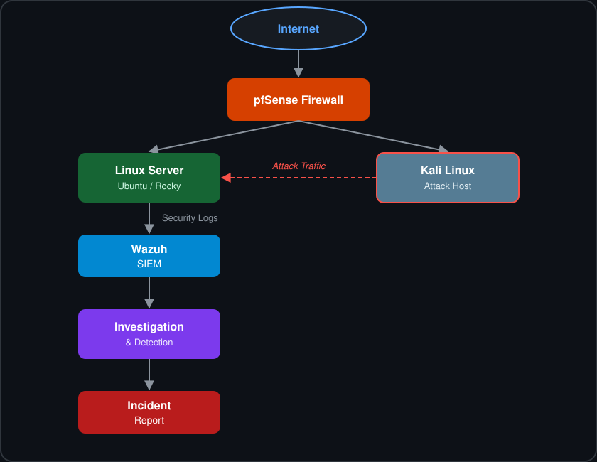

# Changseop Lee (이창섭)

**Junior Security Analyst · Blue Team / SOC**

로그와 네트워크 트래픽에서 공격의 흔적을 찾고,
증거를 기반으로 위협을 분석하는 보안 분석가를 목표로 합니다.


**Contact** `leechangseop71@gmail.com` · **Portfolio** [roror.co.kr](https://roror.co.kr)

<br clear="right">

---

## About Me

Blue Team / SOC 분야를 목표로 학습 중인 Junior Security Analyst입니다.
Linux 보안 로그와 네트워크 패킷을 읽고, 이벤트가 정상인지 비정상인지 판단하는 연습을 해 왔습니다.

**SOC에서 할 수 있는 일**

- IDS(Snort, Suricata) 탐지 이벤트를 확인하고 룰 단위로 원인을 설명
- Wireshark/tshark로 pcap을 분석해 공격 흐름과 증거 정리
- Linux 인증·시스템 로그에서 Source IP와 시간대 기준으로 의심 이벤트 선별
- 분석 과정을 Evidence → Analysis → Conclusion 구조로 문서화

> "Alert는 시작이고, Evidence가 판단을 만든다."

---

## Security Analysis Workflow

```text
Alert Detection
      ↓
Evidence Collection
      ↓
Log & Network Traffic Analysis
      ↓
Event Correlation
      ↓
Attack Timeline Analysis
      ↓
Threat Classification
      ↓
Incident Response
      ↓
Documentation & Detection Improvement
```

| 단계 | 의미 |
|---|---|
| Alert Detection | SIEM·IDS가 보낸 경고를 확인 |
| Evidence Collection | 관련 로그와 패킷을 수집 |
| Log & Traffic Analysis | 로그와 트래픽에서 의심 행위 확인 |
| Event Correlation | 여러 이벤트를 하나의 흐름으로 연결 |
| Attack Timeline Analysis | 시간순으로 공격 과정 재구성 |
| Threat Classification | 공격 유형과 위험도 판단 |
| Incident Response | 차단·격리 등 대응 방안 정리 |
| Documentation & Detection Improvement | 보고서 작성, 탐지 룰 개선 |

> 위 흐름은 학습 중인 분석 절차이며, 실무 경험이 아닙니다.
> 현재 실습은 가상 랩 환경에서 진행했습니다.

---

## Currently

**완료한 실습**

- [x] Ubuntu 기반 Snort 2.9.x IDS/IPS 구성 및 룰 작성
- [x] Suricata → Logstash → Elasticsearch → Kibana 로그 파이프라인 구성
- [x] pfSense Firewall 기본 구성 (WAN/LAN, NAT, 규칙)
- [x] Wireshark 기반 pcap 패킷 분석 및 보고서 작성
- [x] DVWA 대상 Burp Suite / OWASP ZAP 웹 취약점 실습
- [x] Next.js 포트폴리오 사이트 구축 및 배포 (roror.co.kr)

**진행 중인 학습**

- [ ] Linux 인증 로그(`auth.log`, `secure`) 분석 정리
- [ ] Wazuh 기반 SIEM 환경 학습 <!-- 증빙 확인 후 [x]로 변경 -->
- [ ] SSH Brute Force 시나리오 재현·탐지 <!-- 증빙 확인 후 변경 -->
- [ ] Python 로그 파싱 및 보안 자동화 학습 (python-security-basics)

**자격 및 시험**

- [ ] 정보보안산업기사 과정평가형 외부평가 재응시 준비
- [ ] 정보보안기사 학습 <!-- 실제 학습 중일 때만 유지 -->
- [ ] 리눅스마스터 2급 학습 <!-- 실제 학습 중일 때만 유지 -->

---

## Tech Stack


| 분류 | 기술 | 수준 |
|---|---|---|
| Operating Systems | Ubuntu Linux, Rocky Linux, Kali Linux, Windows | Hands-on |
| SIEM & Monitoring | Elastic Stack (Logstash, Elasticsearch, Kibana) | Hands-on (기본 구성) |
| SIEM & Monitoring | Wazuh | Learning |
| Network Security | TCP/IP, Wireshark | Hands-on |
| Network Security | pfSense | Hands-on (기본 구성) |
| IDS / IPS | Snort, Suricata | Hands-on |
| Web Security | Burp Suite, OWASP ZAP | Familiar (DVWA 실습) |
| Programming & Scripting | Bash | Familiar |
| Programming & Scripting | Python | Learning |
| Infrastructure | VMware, Git, GitHub | Hands-on |

---

## Core Security Skills

| 분야 | 할 수 있는 일 |
|---|---|
| SIEM | 보안 이벤트를 수집하고 Kibana 대시보드에서 확인 |
| Log Analysis | Linux 인증·시스템 로그에서 로그인 성공/실패 확인 |
| Network Security | TCP/IP 트래픽의 흐름과 이상 징후 분석 |
| IDS / IPS | Snort/Suricata 탐지 이벤트와 룰의 관계 설명 |
| Packet Analysis | Wireshark로 프로토콜별 패킷 추적, 인증 정보·파일 전송 흔적 확인 |
| Web Security | DVWA로 SQL Injection 등 웹 취약점 재현 및 점검 |
| Incident Analysis | 이벤트를 시간순으로 정리하는 방법 학습 |
| System Security | Linux 계정, 권한, 서비스, 로그 점검 |
| Automation | Python·Bash 기초, 로그 파싱 학습 |

---

## Featured Security Projects

> 각 프로젝트의 상세 증거(스크린샷, 설정 파일, 로그)는 해당 저장소에 정리합니다.
> `[확인 필요]`로 표시된 항목은 증빙 확인 후 갱신 예정입니다.

### Project 01. Wazuh SOC Security Monitoring Lab


<details>
<summary>상세 보기</summary>

| 항목 | 내용 |
|---|---|
| Overview | Ubuntu 기반 Wazuh 보안 모니터링 환경 학습 |
| Objective | Linux 인증 로그를 수집하고 인증 실패 이벤트를 대시보드에서 확인 |
| Lab Environment | VMware, Ubuntu (Wazuh Manager), Linux agent `[확인 필요]` |
| Tools | Wazuh, Linux auth log |
| Implementation | 설치 및 agent 등록 `[확인 필요]` |
| Analysis | 인증 실패 이벤트의 Source IP·Timestamp 확인 `[확인 필요]` |
| Troubleshooting | `[확인 필요]` |
| Evidence | `[확인 필요]` 스크린샷 / 설정 파일 |
| Current Status | 학습 중 |
| What I Learned | `[실제 학습 내용으로 작성]` |

</details>

### Project 02. Suricata IDS & Network Security Lab


<details>
<summary>상세 보기</summary>

| 항목 | 내용 |
|---|---|
| Overview | Suricata 탐지 로그를 ELK 파이프라인으로 시각화하는 환경 |
| Objective | 네트워크 트래픽과 IDS 이벤트의 관계 이해 |
| Lab Environment | VMware, Ubuntu Server 24.04, Kali Linux (공격 호스트) |
| Tools | Suricata, Logstash, Elasticsearch, Kibana |
| Implementation | Suricata 설치·실행 → EVE JSON 확인 → Logstash 수집 → Kibana index pattern 구성 |
| Analysis | 탐지 이벤트와 원본 트래픽 대조 `[사례 추가 필요]` |
| Troubleshooting | Ubuntu 24.04 apt sources 경로 변경 이슈, index pattern 설정 오류 |
| Evidence | `[확인 필요]` 스크린샷 / 설정 파일 |
| Current Status | 기본 파이프라인 구성 완료 |
| What I Learned | IDS 이벤트는 로그 수집과 정규화가 있어야 분석 가능하다는 점 |

</details>

### Project 03. pfSense Firewall Lab


<details>
<summary>상세 보기</summary>

| 항목 | 내용 |
|---|---|
| Overview | VMware 가상 네트워크에서 pfSense 방화벽 구성 |
| Objective | WAN/LAN 구조와 접근 제어 이해 |
| Lab Environment | VMware Workstation, pfSense, Rocky Linux, Windows 10 (내부 호스트) |
| Tools | pfSense, Wireshark |
| Implementation | WAN/LAN 구성, Firewall Rule, NAT |
| Analysis | 허용/차단 트래픽 비교 |
| Troubleshooting | `[확인 필요]` |
| Evidence | `[확인 필요]` |
| Current Status | 기본 구성 및 테스트 완료 |
| What I Learned | 규칙 순서와 방향(In/Out)이 정책 결과를 결정한다는 점 |

pfBlockerNG, Suricata 연동, OpenVPN은 테스트 증거 확인 후 추가합니다.

🔗 [Repository](https://github.com/changseop-blue/pfsense-portfolio) `[링크 확인 필요]`

</details>

### Project 04. Linux Security Log Analysis


<details>
<summary>상세 보기</summary>

| 항목 | 내용 |
|---|---|
| Overview | Linux 인증 로그 분석 학습 |
| Objective | 로그인 성공/실패 패턴과 Source IP 식별 |
| Lab Environment | Rocky Linux / Ubuntu `[확인 필요]` |
| Tools | `auth.log`, `secure`, grep, awk |
| Implementation | `[확인 필요]` |
| Analysis | 반복 인증 실패 패턴 확인 `[확인 필요]` |
| Troubleshooting | `[확인 필요]` |
| Evidence | `[확인 필요]` |
| Current Status | 학습 중 |
| What I Learned | `[실제 학습 내용으로 작성]` |

</details>

### Project 05. Python Security Basics


<details>
<summary>상세 보기</summary>

| 항목 | 내용 |
|---|---|
| Overview | SOC 실무를 가정한 Python 5단계 학습 저장소 |
| Objective | 파일·로그 처리와 로그 파싱 기초 |
| Lab Environment | Python, PyCharm |
| Tools | Python |
| Implementation | 1~5단계 폴더 구조, 한국어 주석 |
| Analysis | `[실제 구현한 기능만 기재]` |
| Troubleshooting | `[확인 필요]` |
| Evidence | 저장소 코드 |
| Current Status | 학습 진행 중 (Capstone 완성 시 갱신) |
| What I Learned | `[실제 학습 내용으로 작성]` |

🔗 [Repository](https://github.com/changseop-blue/python-security-basics) `[링크 확인 필요]`

</details>

### Portfolio Website — roror.co.kr

Next.js 14, TypeScript(App Router) 기반 개인 사이트입니다.
JWT 인증 관리자 페이지와 마크다운 블로그를 운영하며, 글에는 MITRE ATT&CK 참조를 포함합니다.

🔗 [Live Site](https://roror.co.kr) · [Repository](https://github.com/changseop-blue/soc-portfolio) `[링크 확인 필요]`

---

## Home Security Lab

<p align="center">
  
</p>

<!-- 구성도는 실제 구축한 VM과 연결만 포함하는지 확인 후 사용.
     (예: Kali, Ubuntu IDS, Rocky Linux 웹서버) 미구축 장비는 제거. -->

---

## Education & Certifications

| 기관 / 자격 | 과정 | 상태 |
|---|---|---|
| 코리아IT아카데미 | 정보보안산업기사 과정평가형 | 수료 |
| 학점은행제 | 정보보안학 학사 | 진행 중 |
| 정보보안산업기사 | 외부평가 | 재응시 준비 (미취득) |
| 정보보안기사 | 정보보안 이론·실무 | 학습 중 `[확인 필요]` |
| 리눅스마스터 2급 | Linux 시스템 운영 | 학습 중 `[확인 필요]` |

---

## GitHub Activity

[](https://github.com/changseop-blue?tab=repositories)
[](https://roror.co.kr)


<!-- 통계 이미지는 장애가 잦아 접어 둠. 깨지면 이 블록만 삭제 -->
<details>
<summary>GitHub Stats</summary>


</details>

---

## Security Philosophy

무슨 일이 발생했는가 → 왜 발생했는가 → 공격인가 → 어떻게 대응할 것인가.
이 네 질문에 로그와 패킷이라는 객관적 증거로 답하는 분석가가 되겠습니다.
